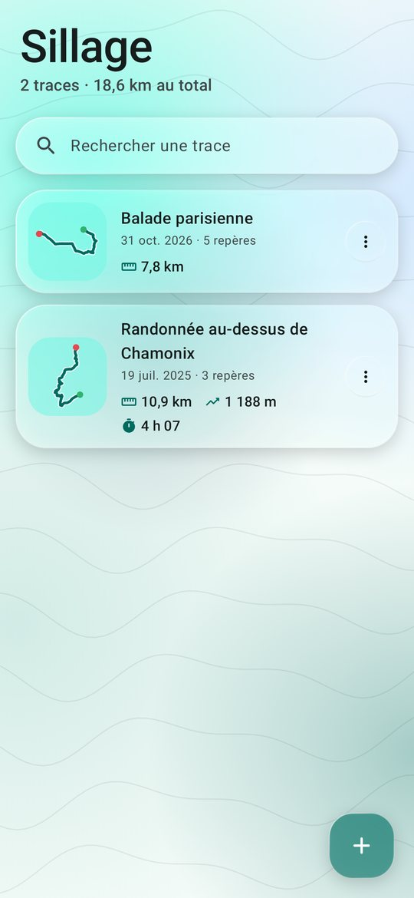
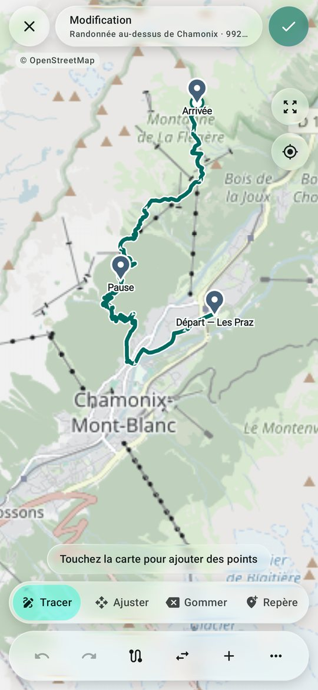
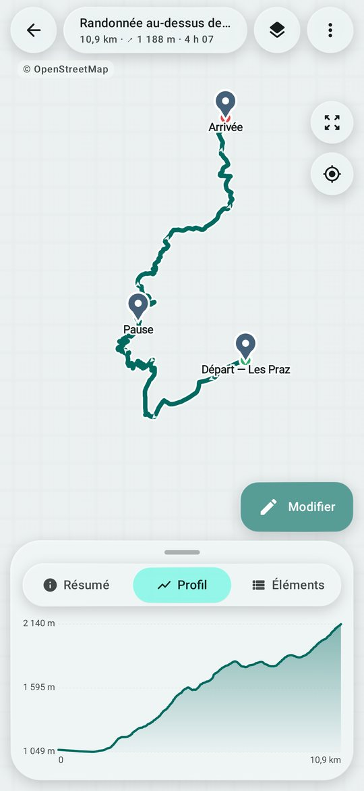
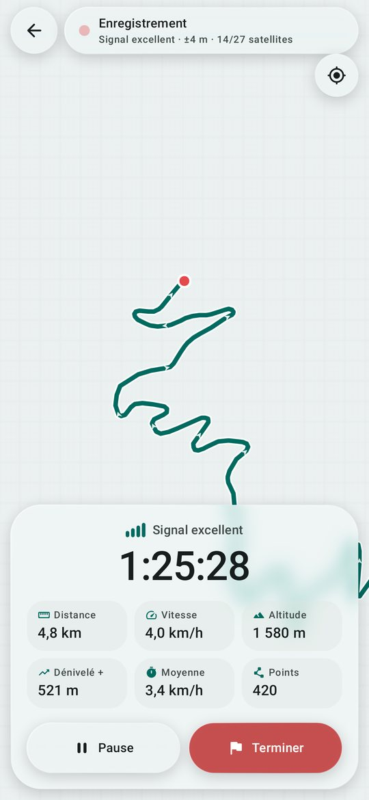
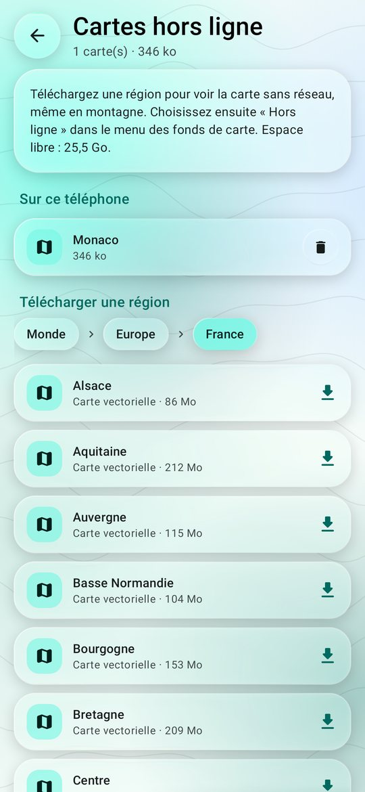
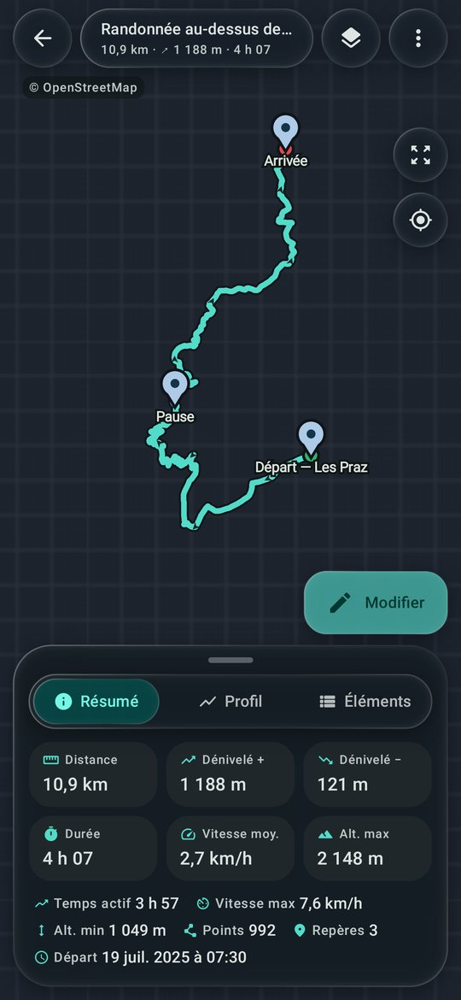

# Sillage — liseuse et éditeur GPX pour Android

Sillage lit, crée et modifie des fichiers GPX. L'interface suit **Material You** (couleurs dynamiques
tirées du fond d'écran) et utilise des surfaces en **verre liquide** qui réagissent au toucher : elles
gonflent sous le doigt, s'étirent dans la direction du geste, suivent légèrement le doigt puis
reviennent en rebondissant. Un reflet lumineux suit aussi le doigt.

| Bibliothèque | Édition | Profil altimétrique |
|---|---|---|
|  |  |  |
| **Enregistrement** | **Cartes hors ligne** | **Thème sombre** |
|  |  |  |

<sub>Ces captures sont générées automatiquement par les tests (Robolectric). Les tuiles de la carte n'ont
pas toujours le temps d'arriver pendant le test : on voit alors la grille d'attente à la place.</sub>

## Télécharger

Chaque compilation publie un APK dans les [Releases](../../releases).
La dernière version est toujours à cette adresse : [Sillage.apk](../../releases/latest/download/Sillage.apk).

Ouvrez le fichier sur le téléphone pour l'installer. Si une clé de signature est configurée (voir
« Compiler »), les versions suivantes s'installent par-dessus, sans perdre vos traces.

## Fonctionnalités

**Lire**
- Import de fichiers GPX 1.0 / 1.1 (sélecteur de fichiers, « Ouvrir avec », partage depuis une autre app).
- Carte OpenStreetMap avec traces, itinéraires (en pointillés), repères, sens de parcours, départ/arrivée.
- Statistiques : distance, dénivelés (lissés contre le bruit GPS / MNT), durée, temps actif, vitesses,
  altitudes min/max.
- Profil altimétrique interactif : en le parcourant du doigt, le point correspondant s'affiche sur la carte.
- Liste des traces, sections, itinéraires et repères ; fiche détaillée d'un repère.
- Fonds de carte : Auto, Clair, Nuit, OpenStreetMap, Topographique (OpenTopoMap), CyclOSM, Hors ligne.

**Créer et modifier**
- Outils : *Tracer* (ajouter des points), *Ajuster* (glisser un point, toucher la ligne pour insérer),
  *Gommer*, *Repère* (poser, renommer, décrire, déplacer).
- **Suivre les chemins** : en traçant, le segment suit les sentiers et routes (à pied, vélo, voiture).
- Annuler / rétablir, nouvelle section, nouvelle trace, inverser le sens, conversion trace ↔ itinéraire,
  simplification (Douglas-Peucker), ajout automatique des altitudes manquantes.
- Métadonnées du fichier (nom, description, auteur).

**Enregistrer**
- Enregistrement de parcours en arrière-plan (écran éteint), avec une notification Pause / Terminer.
- Localisation combinée de Google (GPS + Wi-Fi + réseau mobile), donc un premier point plus rapide et
  plus stable. Sans Google Play Services, l'app utilise le GPS du système.
- Indicateur de signal (précision en mètres, satellites utilisés / visibles), chronomètre, distance,
  vitesse, altitude, dénivelé en direct.
- Filtrage des points : positions imprécises ignorées, pas de « bruit » à l'arrêt, sauts aberrants rejetés,
  une pause crée une nouvelle section.
- Altitude au-dessus du niveau de la mer sur Android 14+. Avant Android 14, les altitudes sont complétées
  par le modèle de terrain à la fin de l'enregistrement, si le réseau est disponible.
- Rien n'est perdu : chaque point est écrit sur disque immédiatement. Après un arrêt brutal,
  l'enregistrement reprend ou est récupéré dans la bibliothèque.

**Cartes hors ligne**
- Téléchargement de cartes vectorielles OpenStreetMap par région (catalogue mapsforge.org : monde →
  continent → pays → région), en arrière-plan avec le gestionnaire de téléchargements d'Android.
- Rendu sur le téléphone, sans réseau : style « Hors ligne » dans le menu des fonds de carte (version
  sombre automatique en thème sombre).

**Gérer**
- Recherche, renommage, duplication, suppression, partage, « Enregistrer sous… » (export GPX 1.1).
- Fichiers d'exemple pour découvrir l'app.

## Le verre liquide

Le code se trouve dans `app/src/main/java/com/sillage/gpx/ui/glass/`.

- `GlassBackdrop` enregistre ce qui est derrière le verre (la carte, ou le fond animé de la
  bibliothèque) dans un `GraphicsLayer`. Chaque surface de verre le redessine à sa position.
- `GlassSurface` applique un flou et une saturation (Android 12+), puis un **shader AGSL de lentille**
  (Android 13+) qui dévie la lumière près des bords, avec une légère dispersion chromatique et un liseré
  de Fresnel. Avant Android 12, le verre devient une surface teintée plus opaque.
- `Bounce` gère la physique au toucher (ressorts peu amortis, étirement directionnel, élastique) sans
  bloquer le défilement des listes. Si une liste prend le geste, l'élément revient en place.
- `LiquidTabs` : l'indicateur est une goutte de verre. Elle s'étire en se déplaçant, suit le doigt quand
  on glisse et gonfle à l'appui.

## Compiler

Prérequis : JDK 17+ et le SDK Android (API 36).

```bash
./gradlew :app:assembleDebug        # app/build/outputs/apk/debug/app-debug.apk
./gradlew :app:assembleRelease      # APK minifié
./gradlew :app:testDebugUnitTest    # tests GPX + captures d'écran dans app/build/screenshots
```

Le workflow GitHub Actions (`.github/workflows/android.yml`) lance les tests, compile, puis crée une
release `v1.0.<numéro de build>` avec `Sillage.apk`. Les captures d'écran sont jointes au build.

**Signature.** Pour que chaque version s'installe par-dessus la précédente, toutes doivent être signées
avec la même clé. Ajoutez-la dans *Settings → Secrets and variables → Actions* du dépôt :
`SILLAGE_KEYSTORE_BASE64` (le fichier `.jks` encodé en base64), `SILLAGE_KEYSTORE_PASSWORD`,
`SILLAGE_KEY_ALIAS` et `SILLAGE_KEY_PASSWORD`. Sans ces secrets, la CI signe avec une clé temporaire.

Minimum : Android 8.0 (API 26). Couleurs dynamiques : Android 12+. Réfraction : Android 13+.
Altitude GPS corrigée (niveau de la mer) : Android 14+.

## Services en ligne utilisés (gratuits, sans clé)

| Usage | Service |
|---|---|
| Fonds de carte | [OpenStreetMap](https://www.openstreetmap.org/copyright), [OpenTopoMap](https://opentopomap.org), [CyclOSM](https://www.cyclosm.org) |
| Suivre les chemins | Serveurs OSRM de [FOSSGIS / routing.openstreetmap.de](https://routing.openstreetmap.de) |
| Altitudes | [Open-Meteo Elevation API](https://open-meteo.com/en/docs/elevation-api) (Copernicus DEM) |
| Cartes hors ligne | [download.mapsforge.org](https://download.mapsforge.org) (données OpenStreetMap) |
| Localisation | Google Play Services (fused location), ou GPS du système |

Ces services ont des conditions d'usage raisonnable. Pour une diffusion à grande échelle, il faudra
passer par un fournisseur de tuiles et de routage dédié.

## Limites connues

- Les extensions GPX propriétaires (fréquence cardiaque, cadence, etc.) sont ignorées. Elles sont donc
  perdues si l'on réenregistre un fichier qui en contient.
- Déplacer un point efface son altitude : utilisez « Ajouter les altitudes » pour la recalculer.
- Les exemples sont des tracés calculés sur OpenStreetMap, avec des horaires simulés.
- Certains constructeurs (Xiaomi, Huawei, Samsung…) ferment agressivement les apps en arrière-plan.
  Pour un long enregistrement, désactivez l'optimisation de batterie pour Sillage.
- Le style « Hors ligne » n'affiche que les régions téléchargées.

## Architecture

```
gpx/      modèle, lecture SAX, écriture GPX 1.1, statistiques, opérations d'édition (pures)
data/     bibliothèque de fichiers, services en ligne
record/   service d'enregistrement, source de localisation, filtre de points, journal
offline/  catalogue et téléchargement des cartes hors ligne
ui/       ViewModel, écrans (bibliothèque, lecture/édition), carte osmdroid, verre liquide, thème
```
